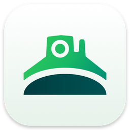
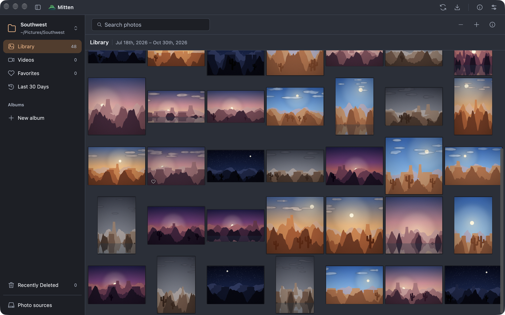
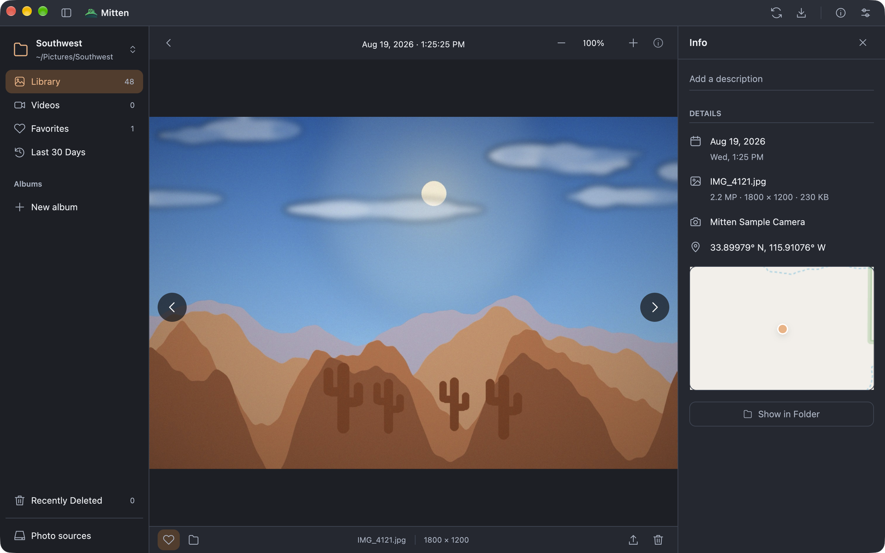

<p align="center">
  
</p>

<h1 align="center">Mitten</h1>

<p align="center"><strong>Fast, private photos from your folders, Apple Photos, Immich and Nextcloud.</strong></p>

<p align="center">
  <a href="https://github.com/pinaltech/Mitten/actions/workflows/ci.yml"></a>
  <a href="LICENSE"></a>
  <a href="Cargo.toml"></a>
</p>

<p align="center">Made by <a href="https://pinal.tech">Pinal Technologies</a> with ❤️</p>





<sub>Screenshots use generated sample photos.</sub>

Mitten is a fast, native photo library written in Rust with GPUI. It runs without Electron or a webview, and it browses the photos you already have where they already are, without copying originals. A quiet sidebar, an adaptive image grid, selection controls and a focused viewer take inspiration from Photos on macOS, with light and dark palettes and a choice of accent colors.

## Build

Requirements: Rust 1.96 or later. Cargo fetches [DesertUI](https://github.com/pinaltech/DesertUI) automatically; no separate checkout is needed. On macOS, Xcode with its command-line tools; they provide clang and the Photos SDK. Runtime Metal shaders need no extra Metal toolchain download. Server credentials are kept in the system keychain on each platform: macOS Keychain, Windows Credential Manager, or the kernel keyring on Linux.

Run from source:

```sh
cargo run --locked
```

Create a Finder-launchable macOS application bundle:

```sh
scripts/bundle-macos.sh
open target/Mitten.app
```

The bundler builds into `target` unless `CARGO_TARGET_DIR` is set, and creates `target/Mitten.app`. It is a development build: it does not install, sign or notarize the app. To regenerate the icon from `assets/brand/mitten.svg`:

```sh
swift scripts/icon.swift /tmp/Mitten.iconset
iconutil -c icns /tmp/Mitten.iconset -o assets/brand/AppIcon.icns
```

## Connect photos

Choose a library from the welcome screen, or drop a local folder into the empty window. Add more from the library switcher at the top of the sidebar; each keeps its own favorites, albums and cache.

| Library      | Connection                                                    | Photos                                                         |
| ------------ | ------------------------------------------------------------- | -------------------------------------------------------------- |
| Local folder | Choose an existing folder                                     | Originals stay in place; changes are found every five seconds  |
| Apple Photos | macOS Photos permission                                       | Read through PhotoKit; albums sync one way                     |
| Immich       | Server URL and API key                                        | Favorites, descriptions and albums sync both ways              |
| Nextcloud    | Server URL, username, app password and an optional folder     | Read through WebDAV with Nextcloud's preview service           |

Originals are never rewritten. Favorites, captions, albums and Recently Deleted are stored by Mitten on this device, except in Immich, where they are written to the server.

## Documentation

- [Using Mitten](docs/USAGE.md): the gallery, viewer, shortcuts, sync behavior and where data is stored
- [Architecture](docs/ARCHITECTURE.md): storage, sources, caching and platform builds
- [Verification](docs/VERIFICATION.md): checks that have been run
- [Gallery transitions](docs/GALLERY_TRANSITIONS.md) and [drag export](docs/DRAG_EXPORT.md): implementation notes
